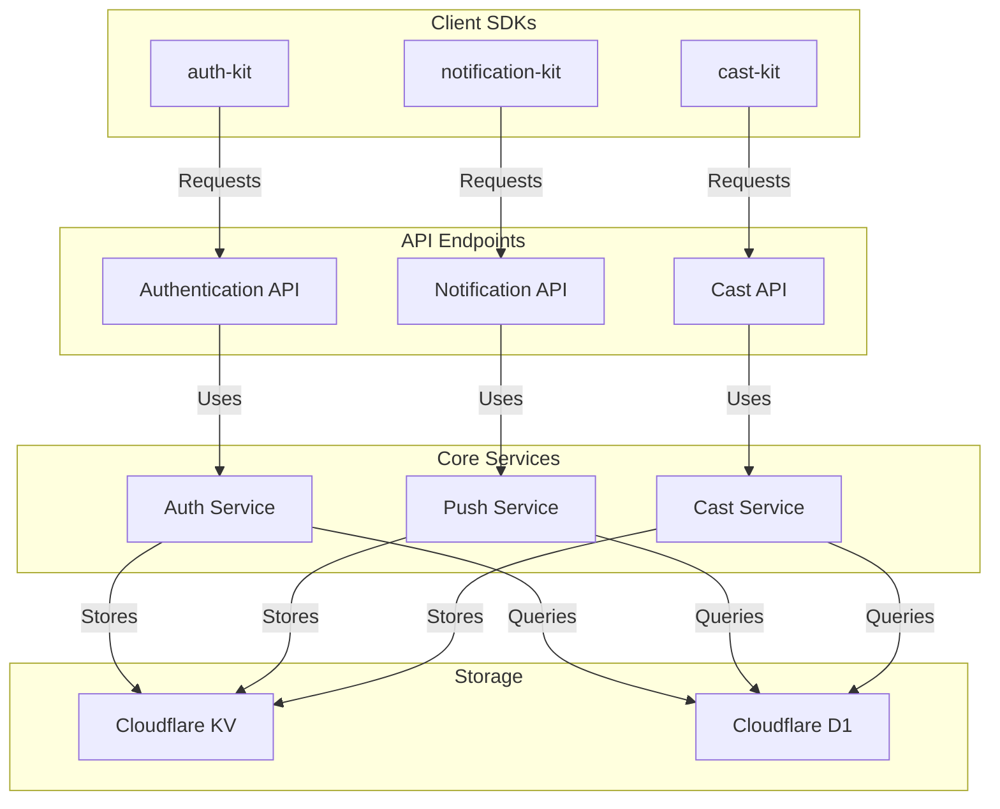

# 🚀 Open Game API

> The official API service for the Open Game System

Open Game API is a Cloudflare Workers application providing the backend services that power the Open Game System (OGS) ecosystem. It implements all the API endpoints defined in the OGS specification, enabling cross-platform features for web games.

[](https://www.typescriptlang.org/)
[](https://workers.cloudflare.com/)
[](LICENSE)

## Features

- 🔐 **Authentication & Account Linking** - Connect game accounts with OGS
- 📱 **Push Notifications** - Send notifications to users across platforms
- 📺 **TV Casting Support** - Backend for Chromecast functionality
- ⚡ **Globally Distributed** - Edge computing via Cloudflare Workers
- 🔄 **Real-time Updates** - WebSocket support for live features
- 🧩 **Modular Architecture** - Extensible design for future features

## Architecture

The Open Game API is built as a Cloudflare Workers application, offering serverless edge computing with global distribution. The architecture consists of:

1. **API Routes**: RESTful endpoints implementing the OGS specification
2. **Authentication Layer**: JWT-based authentication and authorization
3. **Storage Layer**: Cloudflare KV and D1 for data persistence
4. **Notification Service**: Push notification delivery and tracking
5. **Cast Service**: Chromecast session management



## API Endpoints

The API implements all endpoints defined in the [OGS Specification](https://github.com/open-game-system/open-game-system):

### Authentication Endpoints

- `POST /api/v1/auth/account-link-token` - Request an account link token
- `POST /api/v1/auth/verify-link-token` - Verify an account link token
- `POST /api/v1/auth/web-code` - Generate a web auth code
- `POST /api/v1/auth/verify-token` - Verify a web auth token
- `POST /api/v1/auth/refresh` - Refresh an expired session token

### Push Notification Endpoints

- `POST /api/v1/notifications/send` - Send a notification to users
- `GET /api/v1/notifications/status/:id` - Get notification delivery status
- `POST /api/v1/notifications/register` - Register a device for notifications

### TV Casting Endpoints

- `POST /api/v1/cast/session` - Create a cast session
- `POST /api/v1/cast/input` - Send input to a cast session
- `GET /api/v1/cast/session/:id` - Get cast session status
- `DELETE /api/v1/cast/session/:id` - End a cast session

## Development Setup

### Prerequisites

- [Node.js](https://nodejs.org/) (v16 or later)
- [Wrangler CLI](https://developers.cloudflare.com/workers/wrangler/install-and-update/)
- Cloudflare account with Workers enabled

### Local Development

1. Clone the repository:

```bash
git clone https://github.com/open-game-system/opengame-api.git
cd opengame-api
```

2. Install dependencies:

```bash
npm install
```

3. Configure local environment:

```bash
cp .env.example .env
# Edit .env with your configuration
```

4. Start local development server:

```bash
npm run dev
```

The API will be available at `http://localhost:8787`.

### Deployment

Deploy to Cloudflare Workers:

```bash
npm run deploy
```

## Authentication

The API uses JWT-based authentication for secure access:

- **API Keys**: For server-to-server communication (game servers → OGS)
- **Session Tokens**: For authenticated user sessions (OGS app → OGS)

### API Key Authentication

Game servers use API keys to access the OGS API:

```http
POST /api/v1/notifications/send HTTP/1.1
Host: api.opengame.org
Content-Type: application/json
Authorization: Bearer YOUR_API_KEY

{
  "recipient": {
    "gameUserId": "user-123"
  },
  "notification": {
    "title": "Game Invitation",
    "body": "You've been invited to play!"
  }
}
```

### Session Token Authentication

User sessions use short-lived JWTs with refresh tokens:

```http
GET /api/v1/cast/session/session-123 HTTP/1.1
Host: api.opengame.org
Authorization: Bearer USER_SESSION_TOKEN
```

## Data Storage

The API uses Cloudflare's storage solutions:

- **KV**: For high-performance key-value data (tokens, sessions, etc.)
- **D1**: For relational data (user accounts, device registrations, etc.)

## Rate Limiting and Security

The API implements several security measures:

- **Rate Limiting**: Prevents abuse of endpoints
- **CORS**: Controls cross-origin access
- **Input Validation**: Validates all incoming requests
- **Audit Logging**: Records security-relevant events

## Error Handling

All API endpoints return standardized error responses:

```json
{
  "error": {
    "code": "invalid_token",
    "message": "The provided token is invalid or expired",
    "status": 401
  }
}
```

## Monitoring and Analytics

The API collects anonymized usage metrics:

- Request volume per endpoint
- Error rates
- Performance metrics
- Regional distribution

No personally identifiable information is included in analytics.

## Contributing

Contributions are welcome! Please read our [Contributing Guide](CONTRIBUTING.md) for details.

### Development Workflow

1. Fork the repository
2. Create a feature branch (`git checkout -b feature/amazing-feature`)
3. Commit your changes (`git commit -m 'Add amazing feature'`)
4. Push to the branch (`git push origin feature/amazing-feature`)
5. Open a Pull Request

## Support and Community

- GitHub Issues: [https://github.com/open-game-system/opengame-api/issues](https://github.com/open-game-system/opengame-api/issues)
- Discord Community: [Join our Discord](https://discord.gg/opengamesystem)
- Email Support: [hello@opengame.org](mailto:hello@opengame.org)

## License

Open Game API is licensed under the MIT License - see the [LICENSE](LICENSE) file for details.

---

Built with ❤️ by the [Open Game Collective](https://opengame.org/collective) 
